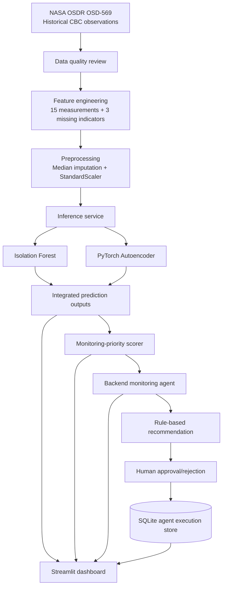

# ASTRAHEALTH AI — System Architecture

## Purpose
ASTRAHEALTH AI is an experimental research prototype that analyzes historical NASA Inspiration4 whole-blood measurements, applies unsupervised anomaly-detection models, combines their outputs with an experimental priority rule set, and presents results in a Streamlit application. It is not a clinically validated medical system.

## High-level architecture

## Data layer
Source: NASA Open Science Data Repository, study OSD-569 — Inspiration4 Whole Blood Measurements.

- Participants: C001–C004
- Original observations: 28; retained ML observations: 27
- Timepoints: L-92, L-44, L-3, R+1, R+45, R+82, R+194
- Model input: 15 selected CBC measurements plus 3 missing-value indicators (18 features)

The C003 L-92 observation was excluded after data-quality review identified serious cross-consistency issues in differential blood count measurements. Five absolute differential-count features were excluded due to the identified source-data consistency issue.

Processed files include `astronaut_health_features_ml.csv`, `astronaut_health_metadata.csv`, `astronaut_health_ml_ready.csv`, and `astronaut_monitoring_results.csv` under `data/processed/`.

## Preprocessing
Module: `src/preprocessing/preprocess.py`

The documented pipeline median-imputes numerical measurements, standardizes numerical features using `StandardScaler`, and passes missing-value indicators through without scaling. Participant-level validation fits preprocessing on each training fold and applies it to that fold's held-out participant.

## Models
**Isolation Forest** — `src/models/isolation_forest.py`
- 100 estimators; `contamination="auto"`; random state 42.
- Produces anomaly flags and anomaly scores.

**PyTorch Autoencoder** — `src/models/autoencoder.py`
- Input 18; encoder 18 → 12 → 6 → 3; decoder 3 → 6 → 12 → 18.
- Latent dimension 3; MSE loss; Adam optimizer; learning rate 0.001.
- 100 epochs; batch size 4; CPU; 669 trainable parameters.
- Reconstruction error is an experimental anomaly indicator. Saved threshold is approximately 0.54127.

## Inference and priority scoring
`src/models/predict.py` loads artifacts, transforms features, generates model outputs, and calls the risk scorer. `src/models/inference_service.py` exposes cached model loading and live dashboard inference.

The scorer in `src/risk_engine/risk_scorer.py` applies +30 for an Autoencoder anomaly flag, +30 for an Isolation Forest anomaly flag, and +20 when reconstruction error exceeds 1.5 × threshold. Categories are 0–20 Routine Monitoring, 30–50 Review Recommended, and 60–80 Priority Review. These are engineering heuristics, not clinically validated rules.

## Agent and persistence
`src/agents/monitoring_agent.py` structures one observation's metadata, model outputs, reconstruction error, existing priority score, explanations, rule-based recommendation, workflow steps, and human-review requirement. It does not retrain models, call an LLM, calculate a second independent risk score, or issue spacecraft commands.

`src/agents/agent_store.py` stores execution metadata, priority, score, serialized result, approval status, reviewer note, and timestamps in `storage/agent_decisions.db`. The Streamlit current-session log is session-scoped; SQLite execution and approval history is persistent.

## Presentation
Main entry point: `frontend/app.py`. Components are under `frontend/components/`; styling is in `frontend/styles/main.css`. The interface includes Agentic AI Control Center, Astronaut Monitoring, AI Anomaly Detection, Decision Support, Mission Timeline, AI Health Assistant, Reports & Analytics, and System Information.

## Artifacts
- `artifacts/models/astronaut_autoencoder.pth`
- `artifacts/models/isolation_forest.joblib`
- `artifacts/preprocessors/health_preprocessor.joblib`
- `artifacts/configs/model_config.json`

## Tests and limitations
The current test suite has 26 passing tests in the development environment. Tests cover software behavior, not clinical accuracy or safety. The dataset has four participants and 27 usable observations, no verified clinical anomaly labels, and contains historical CBC data rather than continuous spacecraft telemetry. Unsupervised anomaly flags are not diagnoses; the priority rules are experimental.
