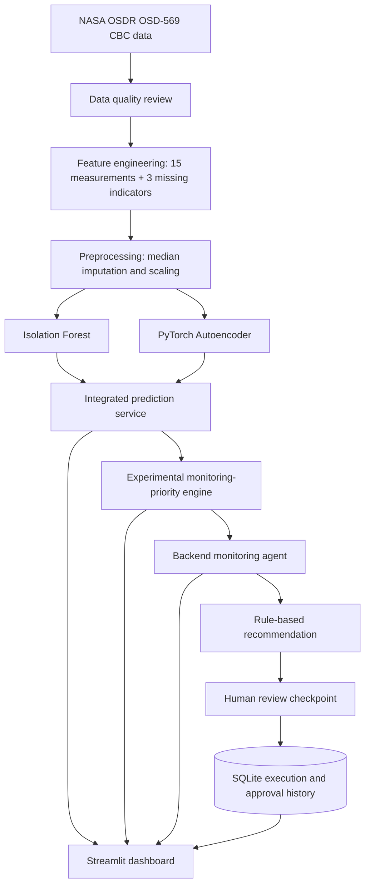

# ASTRAHEALTH AI
### Autonomous Astronaut Health Monitoring and Decision Support System

ASTRAHEALTH AI is an experimental research prototype that analyzes astronaut whole-blood measurements, detects unusual patterns with unsupervised machine learning, and presents monitoring-priority information through a Streamlit dashboard.

**Challenge context:** NASA Space Apps Challenge 2026 — *Health Monitoring Software for Astronauts on Space Missions*  
**Stack:** Python 3.13.5 · PyTorch · scikit-learn · pandas · Streamlit · SQLite  
**Execution:** CPU

> **Research disclaimer:** This is a research and demonstration prototype. It is not a medical device, does not diagnose disease, and does not provide clinically validated risk assessments. Its anomaly flags and monitoring-priority scores are experimental engineering outputs.

## Implemented features

- Preprocessing of selected complete blood count (CBC) measurements.
- An 18-dimensional model input: 15 selected measurement features plus 3 missing-value indicators.
- Unsupervised Isolation Forest anomaly detection.
- PyTorch Autoencoder reconstruction-error anomaly indicator.
- Experimental monitoring-priority engine combining model signals.
- Streamlit dashboard for monitoring, anomaly detection, decision support, timelines, reports, and a rule-based health assistant.
- Backend monitoring workflow that structures existing model outputs into a recommendation.
- SQLite persistence for agent executions and human approval/rejection decisions.
- Pytest coverage for model, preprocessing, prediction, risk-scoring, agent, and storage behavior.

The agent workflow is deterministic and rule-based. It is not an LLM and does not autonomously control spacecraft systems or initiate medical actions.

## Dataset

The project uses NASA Open Science Data Repository study **OSD-569 — Inspiration4 Whole Blood Measurements**.

- Source: https://osdr.nasa.gov/bio/repo/data/studies/OSD-569/
- Participants: C001, C002, C003, C004
- Original timepoints: L-92, L-44, L-3, R+1, R+45, R+82, R+194
- Original CBC observations: 28
- Observations retained for the ML dataset: 27
- Selected measurement features: 15
- Missing-value indicator features: 3
- Final model input: 18 features

The C003 L-92 sample was excluded from the initial ML dataset because the project's data-quality investigation identified serious cross-consistency issues in differential blood count measurements. Five absolute differential-count features were excluded due to the identified source-data consistency issue.

The dataset is small and contains no verified clinical anomaly labels. Results are exploratory model behavior, not diagnostic performance.

## Model design

### Isolation Forest
- 100 estimators
- `contamination="auto"`
- `random_state=42`

### PyTorch Autoencoder
- Input dimension: 18
- Encoder: 18 → 12 → 6 → 3
- Decoder: 3 → 6 → 12 → 18
- Latent dimension: 3
- Loss: Mean Squared Error
- Optimizer: Adam
- Learning rate: 0.001
- Epochs: 100
- Batch size: 4
- Device: CPU
- Training reconstruction threshold: 95th percentile (saved threshold approximately 0.54127)

### Preprocessing
- Median imputation for numerical measurements
- StandardScaler for numerical features
- Missing-value indicator columns passed through without scaling
- Participant-level validation uses Leave-One-Group-Out grouping by `SUBJECT_ID` in the documented experiments.

### Experimental monitoring-priority score

| Signal | Points |
|---|---:|
| Autoencoder anomaly flag | +30 |
| Isolation Forest anomaly flag | +30 |
| Reconstruction error greater than 1.5 × threshold | +20 |
| Maximum | 80 |

| Score | Priority |
|---:|---|
| 0–20 | Routine Monitoring |
| 30–50 | Review Recommended |
| 60–80 | Priority Review |

These weights and boundaries are initial engineering choices, not clinically validated rules. A score is not a probability of disease, medical severity, or clinical risk.

## Validation and interpretation

The ML documentation records four-fold Leave-One-Group-Out experiments, holding out one participant in each fold. In those experiments:

- Isolation Forest produced 21 anomaly flags among 27 held-out observations.
- The Autoencoder threshold experiment produced 24 flags among 27 observations.
- The two models agreed on 24 of 27 observations (88.9%).

**Model agreement is not accuracy.** No verified clinical labels are available to calculate sensitivity, specificity, precision, recall, or diagnostic accuracy. The high flag rate and participant-level variation indicate that generalization and threshold stability require further investigation.

The packaged inference pipeline was also run on 27 observations. Because those observations were used in the final model-development workflow, this integration run is not an independent performance evaluation.

## Architecture



See [`Docs/system_architecture.md`](Docs/system_architecture.md) for expanded module responsibilities.

## Repository structure

```text
ASTRAHEALTH_AI/
├── artifacts/
│   ├── configs/
│   ├── models/
│   └── preprocessors/
├── data/
│   ├── raw/
│   ├── processed/
│   └── synthetic/
├── Docs/
│   ├── ML_DOCUMENTATION.md
│   ├── objectives.md
│   ├── problem_statement.md
│   └── system_architecture.md
├── frontend/
│   ├── components/
│   ├── styles/
│   └── app.py
├── research/
├── src/
│   ├── agents/
│   ├── models/
│   ├── preprocessing/
│   └── risk_engine/
├── storage/
├── tests/
├── requirements.txt
└── README.md
```

## Setup — Windows PowerShell

Run from the repository root:

```powershell
python -m venv venv
.\venv\Scripts\Activate.ps1
python -m pip install --upgrade pip
pip install -r requirements.txt

# Run tests
python -m pytest -q

# Launch dashboard
python -m streamlit run frontend/app.py --server.port 8501
```

Open `http://localhost:8501` in your browser.

The trained model and preprocessor artifacts are expected at the paths below. If they are absent from a clone, recreate them using the project's training workflow before starting inference.

## Model artifacts

- `artifacts/models/astronaut_autoencoder.pth`
- `artifacts/models/isolation_forest.joblib`
- `artifacts/preprocessors/health_preprocessor.joblib`
- `artifacts/configs/model_config.json`

## Tests

The current project test suite contains **26 passing tests** in the development environment.

```powershell
python -m pytest -q
```

Tests check software behavior, transformations, model interfaces, prediction output structure, risk scoring, backend agent orchestration, and SQLite persistence. Passing tests do not establish clinical validity, model accuracy, or medical safety.

## Agent workflow and persistence

The backend agent consumes an observation and outputs already produced by the ML inference pipeline. It structures model outputs, the existing priority score, explanations, and a rule-based recommendation.

SQLite stores agent execution records, monitoring priority and score, structured result payload, approval status, reviewer note, and timestamps.

The default database is created at `storage/agent_decisions.db`. This is runtime data and should generally not be committed to Git.

## Limitations

1. Only four participants and 27 usable observations are available in the ML dataset.
2. No verified clinical anomaly labels are available.
3. Individual participant differences can strongly influence anomaly scores.
4. Experimental thresholds may be unstable with such a small dataset.
5. Agreement between unsupervised models does not establish correctness.
6. Priority weights and categories are not clinically validated.
7. The dataset represents historical blood measurements, not continuous live spacecraft telemetry.
8. The rule-based agent is not an autonomous clinical decision-maker or spacecraft controller.

## Future work

- Evaluate additional astronaut-health datasets and larger cohorts.
- Investigate participant-specific and temporal models.
- Perform threshold sensitivity and distribution-shift analysis.
- Improve feature-level explanations and provenance.
- Seek qualified medical review and clinically meaningful validation before any real-world use.
- Add validated telemetry sources and operational controls if extending beyond historical-data research.

## Source

NASA Open Science Data Repository, study OSD-569:  
https://osdr.nasa.gov/bio/repo/data/studies/OSD-569/

## License

Add a license file before distributing or accepting external contributions. Confirm dataset terms and attribution requirements before redistributing source data.
